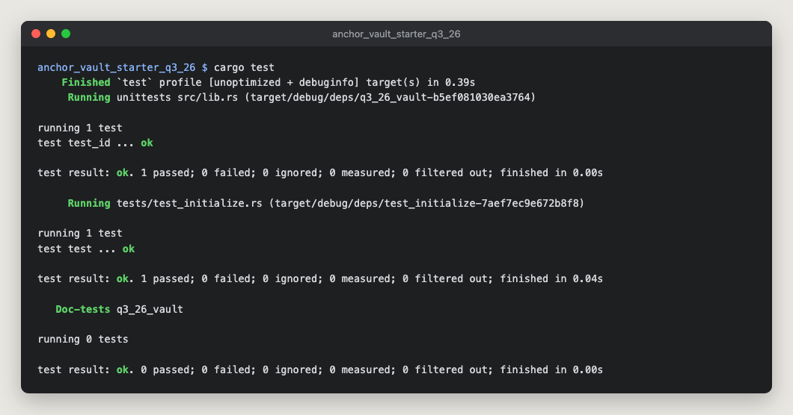

# anchor_vault_starter_q3_26

My Turbin3 Q4 2026 Builders Cohort vault assignment: an Anchor program that gives every user their own SOL vault. It started from [moses7054/anchor_vault_starter_q3_26](https://github.com/moses7054/anchor_vault_starter_q3_26). The starter shipped `initialize` and `deposit`; I wrote `withdraw` and `close` and enabled their steps in the test.

## How it works

Each user gets two PDAs, both derived from their wallet:

| Account | Seeds | What it holds |
|---|---|---|
| `vault_state` | `["state", user]` | A `VaultState` with the bumps of both PDAs, saved once at `initialize` and reused afterwards |
| `vault` | `["vault", user]` | The SOL itself. A plain system account with no data. |

| Instruction | What it does |
|---|---|
| `initialize` | Creates `vault_state` and funds `vault` up to its rent-exempt minimum, so the account exists from the start. |
| `deposit(amount)` | Transfers SOL from the user into `vault` with a System Program CPI. Rejects zero. |
| `withdraw(amount)` | Transfers SOL from `vault` back to the user. Rejects zero, and rejects anything that would take the vault below its rent-exempt minimum (`InsufficientFunds`). |
| `close` | Transfers every lamport left in `vault` to the user, then closes `vault_state` with `close = user`, so the user also gets that account's rent back. |

### Design notes

- **The program signs for the vault.** `vault` is owned by the System Program, so only a System Program transfer can move SOL out of it. `withdraw` and `close` make that CPI with `CpiContext::new_with_signer`, signing with the vault's seeds and the bump stored in `vault_state`. The seeds include the user's key, so a user can only ever drain their own vault.
- **`withdraw` keeps the vault alive; `close` doesn't.** `withdraw` can only take `lamports - rent_exempt_minimum`, so the vault stays a valid account while it's in use. `close` takes everything, rent included. A system account left with 0 lamports is removed by the runtime, so nothing remains on chain.
- **No signer can withdraw from someone else's vault.** Every instruction derives both PDAs from the signer's key; after `initialize`, it uses the bumps stored in `vault_state`. Passing another user's `vault` fails the seeds constraint.

## Tests

[`tests/test_initialize.rs`](programs/q3_26_vault/tests/test_initialize.rs) runs the program in [LiteSVM](https://github.com/LiteSVM/litesvm). A single test walks through a vault's whole lifecycle and checks balances after every step:

| Step | Checked |
|---|---|
| `initialize` | `vault_state` exists; `vault` holds exactly the rent-exempt minimum |
| `deposit` 0.5 SOL | `vault` holds rent + 0.5 SOL |
| `withdraw` 0.1 SOL | `vault` holds rent + 0.4 SOL |
| `close` | `vault_state` is gone; `vault` holds 0 |



## Running it

Requires Rust 1.89 (pinned in `rust-toolchain.toml`), Solana CLI and Anchor CLI 1.1.2.

```bash
anchor build
cargo test
```

The test loads `target/deploy/q3_26_vault.so`, so run `anchor build` first.

`anchor build` warns that the program ID doesn't match the keypair in `target/deploy`. That comes from the starter: its `declare_id!` belongs to a keypair that isn't in the repo, so `anchor build` generated a different one locally. The test deploys the program at its `declare_id!`, so the warning doesn't affect it. Run `anchor keys sync` only if you want to deploy under your own keypair.

## Layout

```
programs/q3_26_vault/
├── src/
│   ├── lib.rs                  # program entrypoints
│   ├── constants.rs            # PDA seeds
│   ├── error.rs                # InvalidAmount, InsufficientFunds
│   ├── state.rs                # VaultState
│   └── instructions/
│       ├── initialize.rs
│       ├── deposit.rs
│       ├── withdraw.rs
│       └── close.rs
└── tests/
    └── test_initialize.rs      # LiteSVM lifecycle test
```
