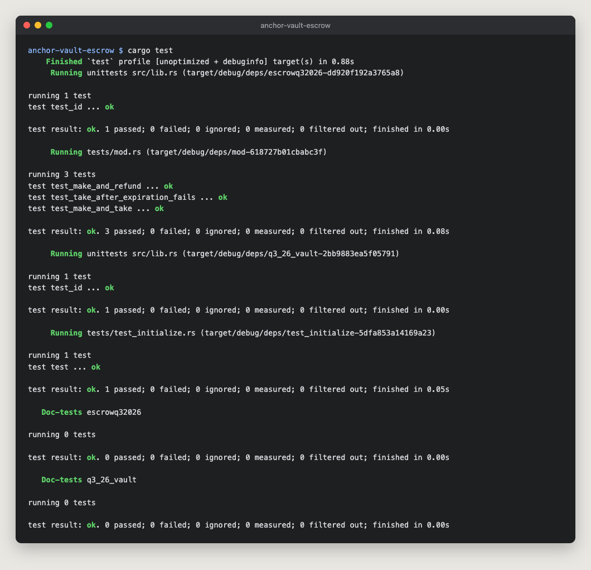

# anchor-vault-escrow

My Turbin3 Q4 2026 Builders Cohort Anchor programs, built and tested together in one Anchor workspace: a per-user SOL vault and a token escrow.

## Vault

Each user gets two PDAs, both derived from their wallet:

| Account | Seeds | What it holds |
|---|---|---|
| `vault_state` | `["state", user]` | A `VaultState` with the bumps of both PDAs, saved once at `initialize` and reused afterwards |
| `vault` | `["vault", user]` | The SOL itself. A plain system account with no data. |

| Instruction | What it does |
|---|---|
| `initialize` | Creates `vault_state` and funds `vault` up to its rent-exempt minimum, so the account exists from the start. |
| `deposit(amount)` | Transfers SOL from the user into `vault` with a System Program CPI. Rejects zero. |
| `withdraw(amount)` | Transfers SOL from `vault` back to the user. Rejects zero, and rejects anything that would take the vault below its rent-exempt minimum (`InsufficientFunds`). |
| `close` | Transfers every lamport left in `vault` to the user, then closes `vault_state` with `close = user`, so the user also gets that account's rent back. |

### Design notes

- **The program signs for the vault.** `vault` is owned by the System Program, so only a System Program transfer can move SOL out of it. `withdraw` and `close` make that CPI with `CpiContext::new_with_signer`, signing with the vault's seeds and the bump stored in `vault_state`. The seeds include the user's key, so a user can only ever drain their own vault.
- **`withdraw` keeps the vault alive; `close` doesn't.** `withdraw` can only take `lamports - rent_exempt_minimum`, so the vault stays a valid account while it's in use. `close` takes everything, rent included. A system account left with 0 lamports is removed by the runtime, so nothing remains on chain.
- **No signer can withdraw from someone else's vault.** Every instruction derives both PDAs from the signer's key; after `initialize`, it uses the bumps stored in `vault_state`. Passing another user's `vault` fails the seeds constraint.

### Tests

[`tests/test_initialize.rs`](programs/q3_26_vault/tests/test_initialize.rs) runs the program in [LiteSVM](https://github.com/LiteSVM/litesvm). A single test walks through a vault's whole lifecycle and checks balances after every step:

| Step | Checked |
|---|---|
| `initialize` | `vault_state` exists; `vault` holds exactly the rent-exempt minimum |
| `deposit` 0.5 SOL | `vault` holds rent + 0.5 SOL |
| `withdraw` 0.1 SOL | `vault` holds rent + 0.4 SOL |
| `close` | `vault_state` is gone; `vault` holds 0 |

## Escrow

A maker deposits token A into a vault owned by the escrow PDA `["escrow", maker, seed]` and names how much token B they want for it. A taker pays that token B and receives the vault's token A in the same transaction. Until someone takes the offer, the maker can take their tokens back.

| Instruction | State |
|---|---|
| `make(seed, deposit, receive, expiration)` | From the starter. Creates the escrow and its vault, deposits token A, and stores an expiry timestamp. |
| `refund` | From the starter. Returns token A to the maker and closes the vault and the escrow. |
| `take` | Written by me. Fails with `EscrowExpired` once the clock sysvar reaches the expiry. Otherwise the taker pays the maker the token B they asked for and receives all of the vault's token A. The escrow PDA signs both the vault transfer and the vault's closing, and the maker gets the rent of the vault and the escrow back. If the taker's token A account or the maker's token B account doesn't exist yet, `take` creates it, paid for by the taker. |
| `update` | To write. Will let the maker change the escrow's terms before anyone takes it. |

[`tests/mod.rs`](programs/escrowq32026/tests/mod.rs) runs the escrow in LiteSVM:

| Test | Checked |
|---|---|
| `test_make_and_refund` (from the starter) | `make` fills the vault and records the offer; `refund` closes the vault and the escrow |
| `test_make_and_take` | The taker receives all of token A and pays exactly the token B asked for, which lands in the maker's new token account. The vault and the escrow are closed, and the maker's SOL goes up by exactly their rent. |
| `test_take_after_expiration_fails` | With the clock moved to the expiry second, `take` fails with `EscrowExpired`, and the vault and the taker's balances are unchanged |

A test for `update` will come with it. The starter's diagrams of each flow are in [`docs/escrow`](docs/escrow).

## Running it

Requires Rust 1.89 (pinned in `rust-toolchain.toml`), Solana CLI and Anchor CLI 1.1.2.

```bash
anchor build
cargo test
```

`cargo test` runs both programs' tests. Each test loads its program from `target/deploy`, so run `anchor build` first. All six pass:



`anchor build` warns that a program ID doesn't match the keypair in `target/deploy`. That comes from the starters: their `declare_id!`s belong to keypairs that aren't in the repo, so `anchor build` generates different ones locally. The tests deploy each program at its `declare_id!`, so the warning doesn't affect them. Run `anchor keys sync` only if you want to deploy under your own keypairs.

## Layout

```
anchor-vault-escrow/
├── Anchor.toml                   # registers both programs
├── docs/
│   ├── cargo-test.png            # cargo test output for both programs
│   └── escrow/                   # make, take and refund diagrams from the escrow starter
└── programs/
    ├── q3_26_vault/
    │   ├── src/
    │   │   ├── lib.rs            # program entrypoints
    │   │   ├── constants.rs      # PDA seeds
    │   │   ├── error.rs          # InvalidAmount, InsufficientFunds
    │   │   ├── state.rs          # VaultState
    │   │   └── instructions/     # initialize, deposit, withdraw, close
    │   └── tests/
    │       └── test_initialize.rs  # LiteSVM lifecycle test
    └── escrowq32026/
        ├── src/
        │   ├── lib.rs            # program entrypoints
        │   ├── constants.rs      # escrow seed
        │   ├── error.rs          # EscrowExpired
        │   ├── state.rs          # Escrow
        │   └── instructions/     # make, take, refund
        └── tests/
            └── mod.rs            # LiteSVM make/refund, make/take and expired-take tests
```
