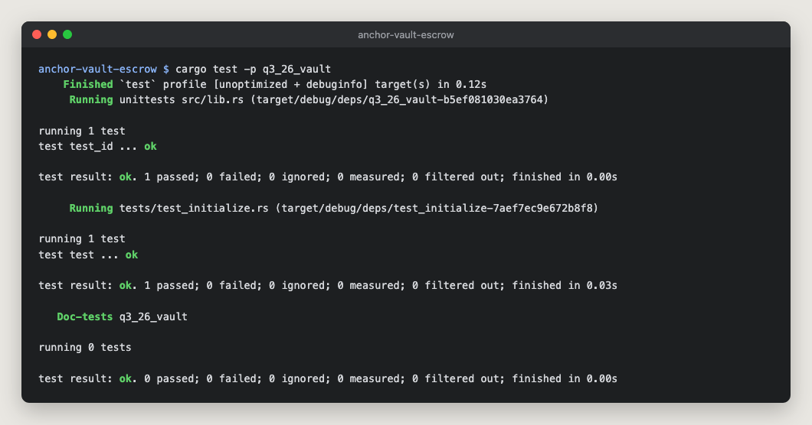
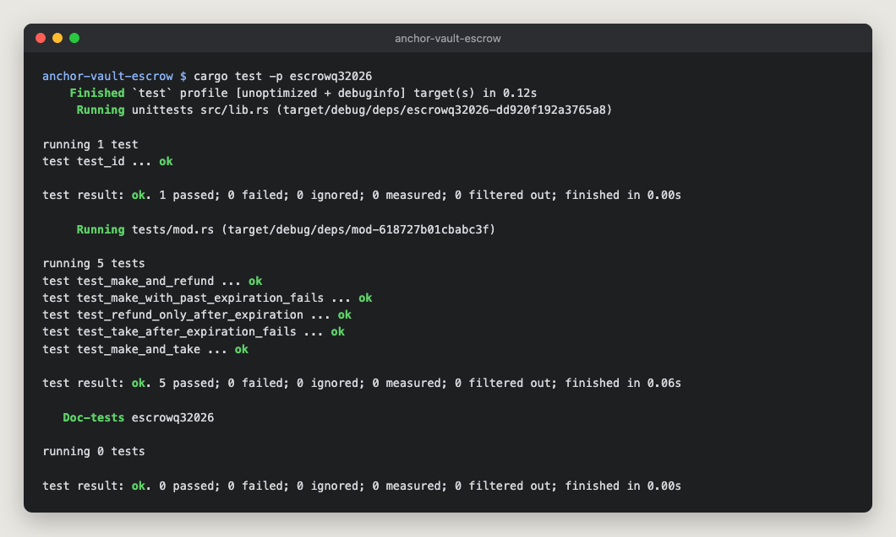

# anchor-vault-escrow

Two Anchor programs from the Turbin3 Q4 2026 Builders Cohort, in one workspace: a SOL vault and a token escrow.

## Vault

Every user gets their own vault, made of two PDAs seeded with their key:

- `vault_state` (`["state", user]`) stores the bumps.
- `vault` (`["vault", user]`) is a system account that holds the SOL.

| Instruction | What it does |
|---|---|
| `initialize` | Creates `vault_state` and funds `vault` with its rent-exempt minimum (starter) |
| `deposit(amount)` | Moves SOL from the user into the vault (starter) |
| `withdraw(amount)` | Moves SOL back to the user, but never below the rent-exempt minimum |
| `close` | Sends everything left to the user and closes `vault_state` |

The vault is owned by the System Program, so `withdraw` and `close` move SOL with a System Program transfer that the program signs with the vault's seeds. The seeds include the user's key, so nobody can touch someone else's vault.

### Tests

[`test_initialize.rs`](programs/q3_26_vault/tests/test_initialize.rs) takes one vault through initialize, a 0.5 SOL deposit, a 0.1 SOL withdraw and close in LiteSVM, and checks the balances after each step.



## Escrow

The maker locks token A in a vault owned by the escrow PDA (`["escrow", maker, seed]`) and asks for an amount of token B. A taker sends that token B and gets the token A in the same transaction.

It's a timed escrow. The offer stays open until `expiration`, a unix timestamp checked against the clock sysvar. Before then only a taker can close it, and from then on only the maker can, by taking their tokens back. A taker always gets the full window, and the maker's tokens never get stuck.

| Instruction | What it does |
|---|---|
| `make(seed, deposit, receive, expiration)` | Creates the escrow and its vault and deposits token A. Rejects an `expiration` that isn't in the future. |
| `take` | Before `expiration`: swaps the tokens and closes the vault and escrow, with the rent going back to the maker |
| `refund` | From `expiration` on: returns token A to the maker and closes the vault and escrow |
| `update` | Not written yet |

`make` and `refund` came with the starter; I added their time checks and wrote `take`.

### Tests

[`tests/mod.rs`](programs/escrowq32026/tests/mod.rs):

- `test_make_and_take`: takes one second before the expiry; both sides get their tokens, the vault and escrow are closed, and the maker gets the rent back
- `test_make_with_past_expiration_fails`: `make` with an expiry of right now fails with `ExpirationInPast`
- `test_take_after_expiration_fails`: at the expiry, `take` fails with `EscrowExpired` and no tokens move
- `test_refund_only_after_expiration`: `refund` fails with `EscrowNotExpired` one second before the expiry, then works at the expiry
- `test_make_and_refund` (starter): now moves the clock to the expiry before refunding



The diagrams in [`docs/escrow`](docs/escrow) come from the starter.

## Running it

Needs Rust 1.89, the Solana CLI and Anchor 1.1.2.

```bash
anchor build
cargo test
```

`cargo test -p q3_26_vault` or `cargo test -p escrowq32026` runs one program's tests.

Program IDs: vault `7FVNbGegQQGivf5T6Fv6d15p3SyNxWdz8NNLScrSUi5q`, escrow `Dx7f9RCcCJaLTjwVExhD5FooxCw9rP24CoUbXvCkMdUG`. The keypairs aren't committed, so on a fresh clone run `anchor keys sync` after the first `anchor build`, then build again.
